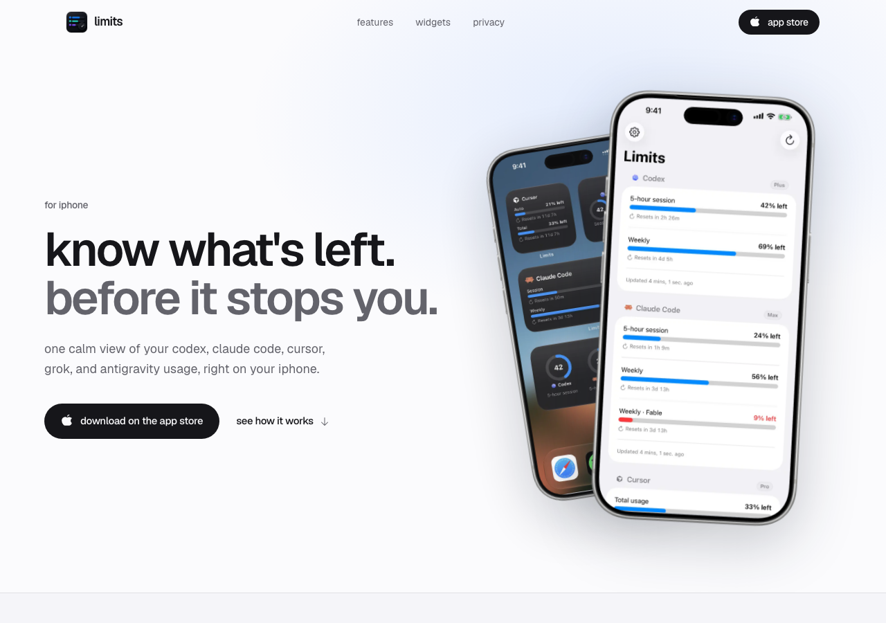
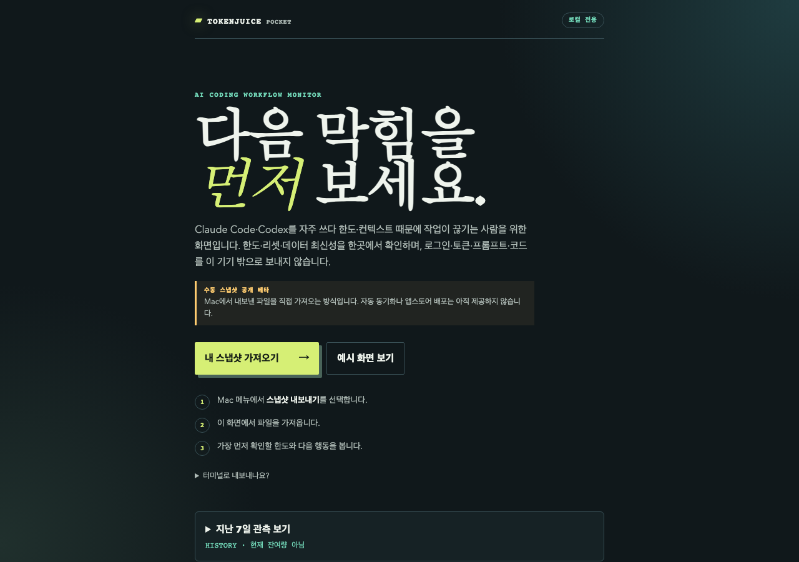
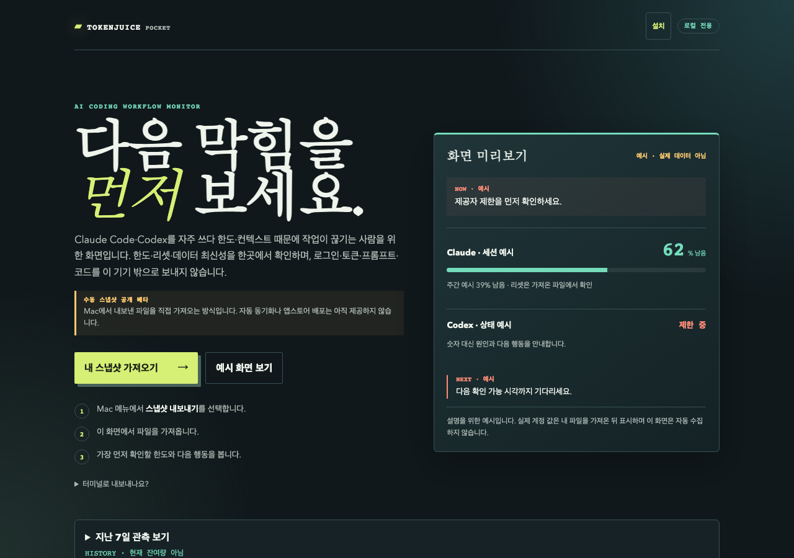

# 공개 첫 화면 UI/UX 비교 — 2026-10-13

같은 과제: 비로그인 신규 방문자가 목적과 시작 경로를 찾을 수 있는가.
같은 조건: 격리 Chromium/networkidle, 375×812 및 1280×900. 모든 URL HTTP 200,
해당 프레임의 가로 넘침 없음. 실제 설치/결제/provider 정확성·전환율·native 사용성
전체 평가는 아니다. Firecrawl/SEO 미연결. label 기반 가져오기 CTA는 a/button DOM
수집에서 제외되므로 TokenJuice에 가져오기 버튼이 없었다고 판정하지 않는다.

## 첫 사용자 과제의 직접 관측

| 제품/공식 출처 | 관찰 표면 | 모바일 시작 경로 좌표 | 시각 구성 | 미검증 |
|---|---|---|---|---|
| [Limits](https://getlimits.app/) | 공개 랜딩 | App Store y434/h51 | 밝은 배경·큰 산세리프·기기/위젯 이미지·2열 desktop hero | 로그인·Pro·native 위젯 |
| [AI Limits Tracker](https://ailimits.app/) | 공개 랜딩 | iOS/Mac/Play y459/515/571, h48 | 밝은 배경·여러 기기 제품 이미지·채널별 CTA | 실제 연결/갱신·앱 품질/결제 |
| [OpenUsage](https://openusage.sh/) | 공개 랜딩 | 설치 앵커 y533/h41, 문서 y586/h43 | 어두운 바탕·픽셀 로고·모노스페이스·절제된 강조 | terminal 실행·지원 정확성 |
| [VibeUsage](https://vibeusage.com/) | 공개 랜딩 | 명령 복사 y441/h29 | 밝은 바탕·세리프/산세리프 혼용·터미널 예시·설치 명령 | 명령 실행·실데이터·절감 효과 |
| [ClaudeCodeUsage](https://github.com/ClaudeCodeUsage/ClaudeCodeUsage) | GitHub 저장소 진입 | 범용 GitHub nav를 제품 CTA와 비교하지 않음 | VS Code UI가 아닌 저장소 표면 | 실제 extension/대시보드·설치 |
| TokenJuice 공개 v27 | Pocket 빈 상태 | 가져오기·예시 있음; 설치 링크는 첫 화면에 없음 | dark teal/serif·수동 베타 안내; 결과 예시는 클릭 뒤 | 신규 설치·현재 quota·native/sync |

좌표는 당시 bounding rect이며 hit area 전체나 접근성 합격/불합격을 의미하지 않는다.
폰트·위계·이미지는 직접 시각 관찰이다. 전환이나 선호도 효과는 측정하지 않았다.

## 같은 프레임 원자료

| Limits desktop | TokenJuice v27 desktop |
|---|---|
|  |  |

추가 원자료: [AI Limits Tracker](../competitor-profiles/raw/ai-limits-tracker/2026-10-13/scrapes/ui-first-fold.md),
[OpenUsage](../competitor-profiles/raw/openusage/2026-10-13/scrapes/ui-first-fold.md),
[VibeUsage](../competitor-profiles/raw/vibeusage/2026-10-13/scrapes/ui-first-fold.md),
[ClaudeCodeUsage](../competitor-profiles/raw/claudecodeusage/2026-10-13/scrapes/ui-first-fold.md).
375/1280 스크린샷과 관측 노트를 날짜 폴더에 보존했다.

## 수정 후 로컬 후보

이 캡처는 가짜 계정값을 표시한 정적 미리보기이며 실제 Claude 인증 복구가 아니다.
[375px 후보](../competitor-profiles/raw/tokenjuice/2026-10-13/screenshots/candidate-375.png)도
가로 넘침 없이 설치 진입점과 기존 가져오기/예시 행동을 유지한다. 공개 반영은 CI/byte
확인 뒤 audit 후속에 기록한다. 순수 시각 인상을 설치 성공이나 지불 의향으로 바꾸지 않는다.

## 개선 체크리스트

| 항목 | 관측 차이 | 이번 구현/검증 | 남은 조건 |
|---|---|---|---|
| U01 시작 경로 | 이미 파일이 있는 사용자 중심 | 상단 44px 설치 링크·직접 기기 선택·소스/EXE 고정 URL | 실제 다운로드·신규 설치 성공 |
| U02 제품 먼저 보여주기 | desktop 결과가 클릭 뒤에 있음 | 2열 hero·명시적 예시 카드·1280×900 첫 화면 노출 | 선호/전환 측정·모바일 결과 확인 과제 |
| U03 플랫폼 안내 | iPhone Mac 문자열로 잘못 분기 | 모바일 우선 red→green·touch Mac/iPad 휴리스틱·직접 선택·키보드 | 실제 hardware/브라우저 검증 |
| U04 설치 맥락 | 저장소 없는 사용자에게 상대 명령만 있음 | ZIP 압축/터미널 맥락·중복 복제 금지·Python 포함 EXE 구분 | 서명 Mac 앱·Windows 실기기 설치 |
| U05 예시/신뢰 경계 | 숫자를 실제 값으로 오인할 위험 | 예시·비실데이터 표시·저장/수집/외부 호출 0·기존 파일 흐름 회귀 | 실제 Claude 인증과 정확성 |
| U06 native 편의 | 모바일 수동 전달 마찰 | frontend 수정을 자동 연결로 주장하지 않음 | 자동 sync/widget·background/auth·스토어 |
| U07 전체 경쟁 품질 | 공개 랜딩만으로 앱 평가 불가 | 공개 설명/직접 화면/미검증 분리 | 같은 실제 연결/한도/오류 복구 native 과제·사용자 5명 |

디자인 해석: 흰 배경을 복제하기보다 기존 serif/teal/lime 정체성에 목적→화면 예시→
시작 경로→제한 안내를 연결하는 것이 이번 수정의 의도다. 실제 사용자 검증 전에는
경쟁사 수준 달성이나 전체 디자인 완료를 점수로 선언하지 않는다.
